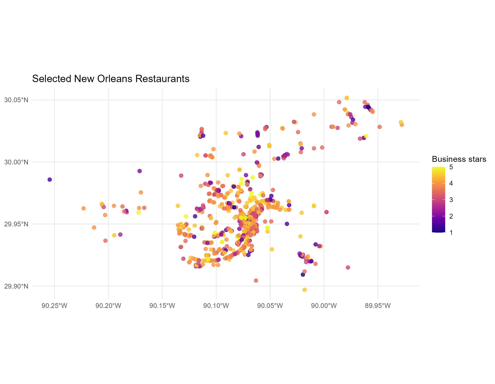
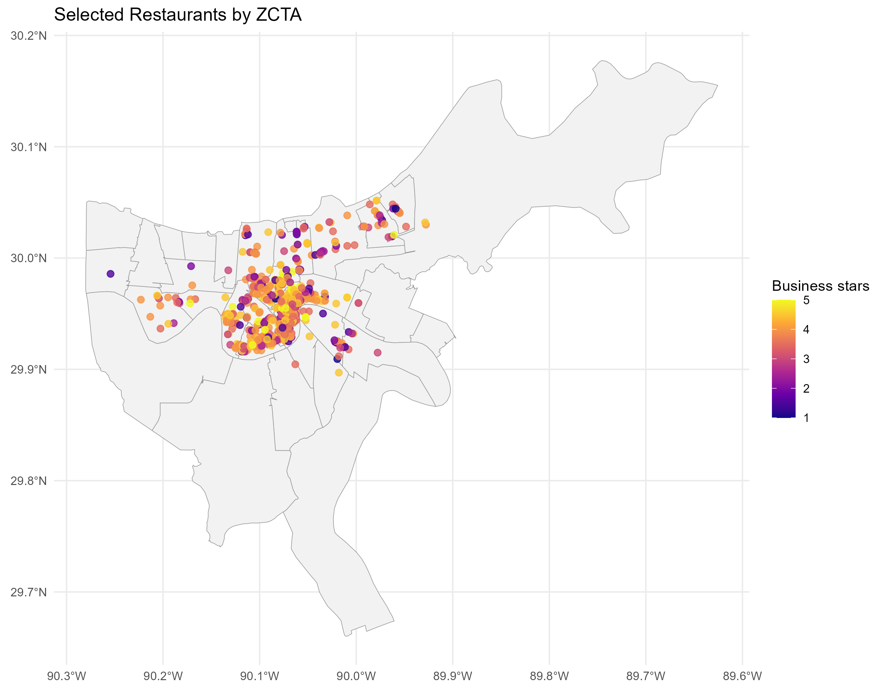
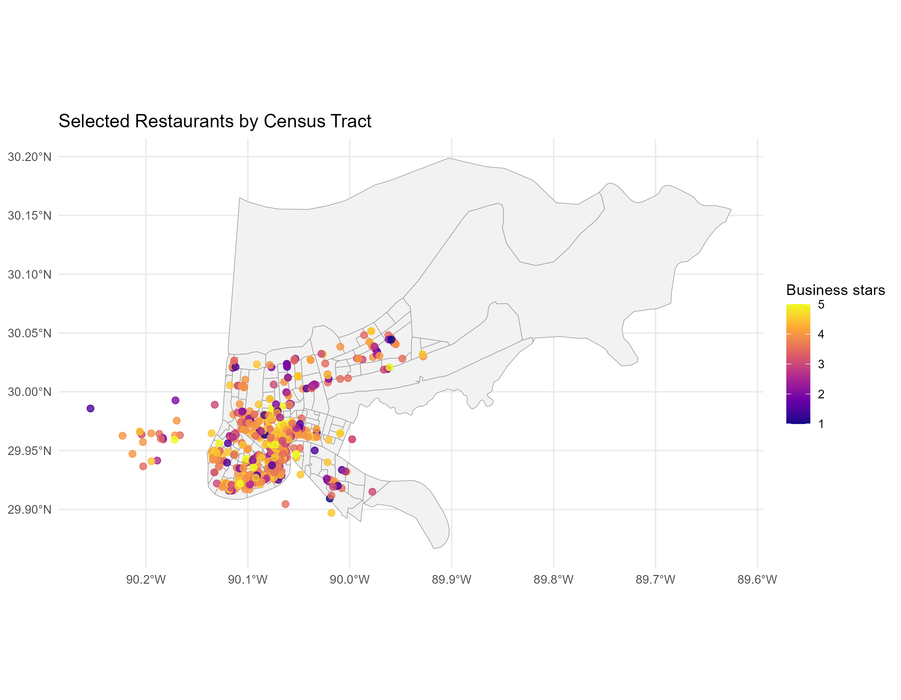
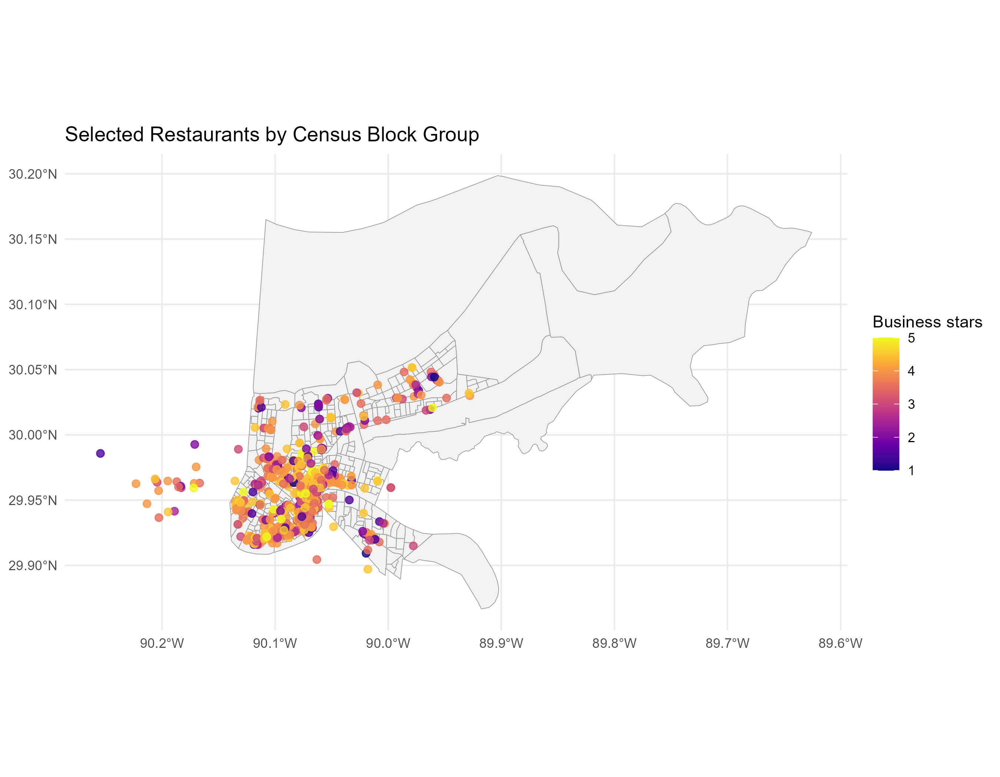

## Research question

Which geographic system provides the clearest way to compare the locations and business ratings of selected restaurants in New Orleans?

This report examines selected restaurants across New Orleans. The analysis compares three ways of dividing the city: ZIP Code Tabulation Areas (ZCTAs), Census tracts, and Census block groups. The goal is to determine which system makes restaurant locations and business ratings easiest to compare.

## Data and workflow

The analysis uses the filtered Yelp business and review data saved in the following RDS files:

- `data/new_orleans/business_new_orleans.rds`
- `data/new_orleans/reviews_new_orleans.rds`

The analysis code is available in [`R/new_orleans_restaurant_geography_analysis.R`](R/new_orleans_restaurant_geography_analysis.R).

First, I separated the restaurant categories listed in the Yelp data. I then selected a related group of New Orleans restaurants and connected those businesses to their reviews using `business_id`. Finally, I converted the Yelp latitude and longitude values into `sf` point objects and matched the points to official Census boundaries with spatial joins. The boundary data use 2020 Census geography files so the systems are compared consistently.

```{r}
#| eval: false
#| include: false

source("R/new_orleans_restaurant_geography_analysis.R")
```

## Restaurant categories

I selected the following categories:

- Cajun/Creole
- Seafood
- Southern
- Sandwiches
- Fast Food
- Food Trucks

I chose these categories because I wanted to find New Orleans style casual and convenient dining options. A business was included if its Yelp category list contained at least one of these categories. This rule allows a restaurant to belong to more than one category while preventing unrelated businesses from entering the analysis.

The complete category-count table is available here(all paths listed are repo paths to files):

[`tables/all_restaurant_category_counts.csv`](tables/all_restaurant_category_counts.csv)

```{r}
#| echo: false

category_counts <- read.csv(
  "tables/all_restaurant_category_counts.csv",
  stringsAsFactors = FALSE
)

knitr::kable(
  head(category_counts, 20),
  caption = "Top 20 restaurant categories in the New Orleans business data"
)
```

## Selected restaurant data

The analysis script also creates summaries of the selected restaurants and their reviews:

- [`tables/selected_data_summary.csv`](tables/selected_data_summary.csv)
- [`tables/selected_restaurants.csv`](tables/selected_restaurants.csv)

I filtered the review data so that it only includes reviews for the selected restaurants. This keeps reviews for unrelated businesses out of the rest of the analysis.

## Restaurant locations

The selected restaurants were converted from latitude and longitude values into spatial points.



## Geographic area systems

I compared three geographic systems:

1. ZIP Code Tabulation Areas (ZCTAs)
2. Census tracts
3. Census block groups

ZCTAs are Census approximations of ZIP-code service areas. They are useful for postal and business-location questions, but they are not automatically neighborhoods. Census tracts are statistical areas designed for population and demographic analysis. Census block groups are smaller areas within tracts and provide more detail.

I compared all three systems because the restaurant distributions can look different depending on how New Orleans is divided. Larger areas may be easier to understand and may contain more restaurants, while smaller areas may show more detail but contain too few restaurants for reliable comparisons. I did not add Neighborhood Statistical Areas or wards because the three Census systems already provide enough of a practical comparison for this restaurant-location question. For each system, I used the same restaurant point object, performed a spatial join, counted restaurants by area, calculated average and median business stars, recorded total reviews, and checked for unmatched points. The reviewer adjusted rating is not used at this stage because that measure will eventually be used at a later reviewer normalization part of the project.

The analysis follows this pattern for each boundary dataset:

```{r}
#| eval: false

restaurants_by_area <- restaurant_points |>
  sf::st_join(area_boundaries, join = sf::st_within, left = TRUE) |>
  sf::st_drop_geometry() |>
  dplyr::group_by(area_name) |>
  dplyr::summarise(
    number_of_restaurants = dplyr::n(),
    average_business_stars = mean(stars, na.rm = TRUE),
    median_business_stars = median(stars, na.rm = TRUE),
    .groups = "drop"
  )
```

The actual boundary and identifier names differ between ZCTAs, tracts, and block groups. Those names are handled in `R/new_orleans_restaurant_geography_analysis.R`.

## Geographic comparison

The comparison table reports the number of areas, restaurants assigned, unmatched restaurants, and the smallest and largest restaurant counts per area.

[`tables/geographic_system_comparison.csv`](tables/geographic_system_comparison.csv)

```{r}
#| echo: false

geography_comparison <- read.csv(
  "tables/geographic_system_comparison.csv",
  stringsAsFactors = FALSE
)

knitr::kable(
  geography_comparison,
  caption = "Comparison of geographic systems for the selected restaurants"
)
```

The detailed summary tables also include the number of restaurants, average business stars, median business stars, and total reviews for each area (repo paths):

- [`tables/zcta_restaurant_summary.csv`](tables/zcta_restaurant_summary.csv)
- [`tables/census_tract_restaurant_summary.csv`](tables/census_tract_restaurant_summary.csv)
- [`tables/block_group_restaurant_summary.csv`](tables/block_group_restaurant_summary.csv)

The comparison results are:

- ZCTAs: 28 areas, 1,057 restaurants assigned, and 0 unmatched restaurants. Counts range from 1 to 289 restaurants per area.
- Census tracts: 130 areas, 1,030 restaurants assigned, and 27 unmatched restaurants. Counts range from 1 to 192 restaurants per area.
- Census block groups: 209 areas, 1,030 restaurants assigned, and 27 unmatched restaurants. Counts range from 1 to 67 restaurants per area.

All three systems include areas with only one restaurant. These small-area results should be interpreted with a lighter weight because a single business in these smaller areas can determine the entire area's average rating. The larger areas with many restaurants provide more reliable averages, but they can hide smaller local differences. But, generally larger areas are preferred. 

## Restaurants by ZCTA



## Restaurants by Census tract



## Restaurants by Census block group



## Geographic system selection

I selected ZCTAs as the geographic system for this stint of the project. This choice fits the research question because the analysis is about restaurant locations and business ratings, which can be reasonably compared using postal area approximations. ZCTAs are also easier to understand compared to Census tracts or block groups. Census tracts and block groups provide smaller geographic areas and more visual detail. However, both systems left 27 restaurants unmatched, and both contain areas with very few restaurants. This makes some area level comparisons less stable/reliable because the rating of one or two businesses can strongly affect the average for the entire area. Their maps also have many more boundaries, which makes the overall pattern harder to read.

ZCTAs assigned every selected restaurant, produced the simplest map, and still showed meaningful differences in restaurant concentration across New Orleans. The main limitation is that ZCTAs are larger and less detailed, so they may hide smaller neighborhood level patterns. They should be described as Census approximations of ZIP code areas, not as exact neighborhood boundaries. Overall, ZCTAs provide the clearest and most complete system for the current question, while the tract and block-group maps show what additional detail is lost.

## Limitations

The Yelp `city` field and Census boundaries may not match perfectly. For example, a business may use a postal city label that differs from the area containing its coordinates. Areas with very few restaurants also produce less stable averages as previously stated. Finally, these results describe a set of specifically selected Yelp businesses and should not be treated as a complete list of every restaurant in New Orleans.

## Source code and outputs

- Analysis code:(R/new_orleans_restaurant_geography_analysis.R)
- All category counts:(tables/all_restaurant_category_counts.csv)
- Selected restaurant summary:(tables/selected_data_summary.csv)
- Geographic comparison table:(tables/geographic_system_comparison.csv)
- Restaurant location map:(figures/new_orleans_restaurant_locations.png)
- ZCTA map:(figures/restaurants_by_zcta.png)
- Census tract map:(figures/restaurants_by_census_tract.png)
- Census block group map:(figures/restaurants_by_block_group.png)
