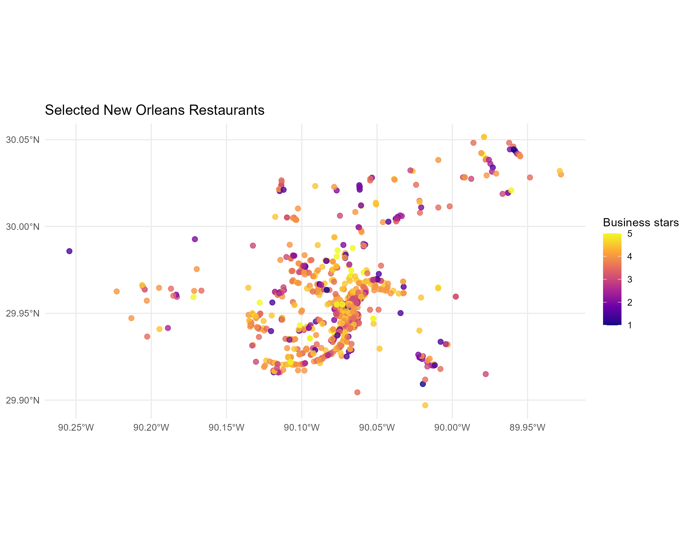
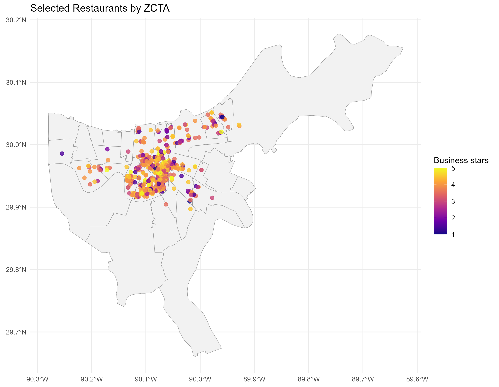
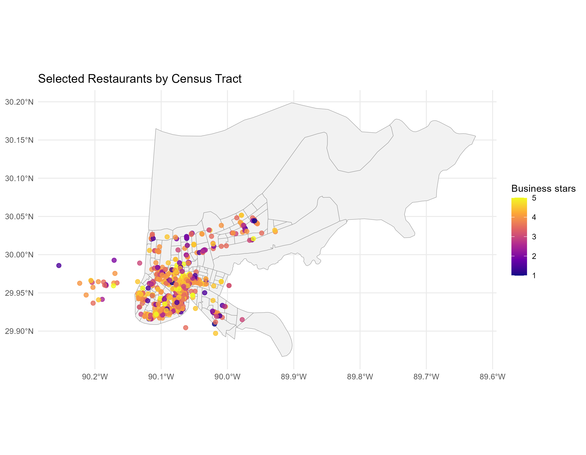
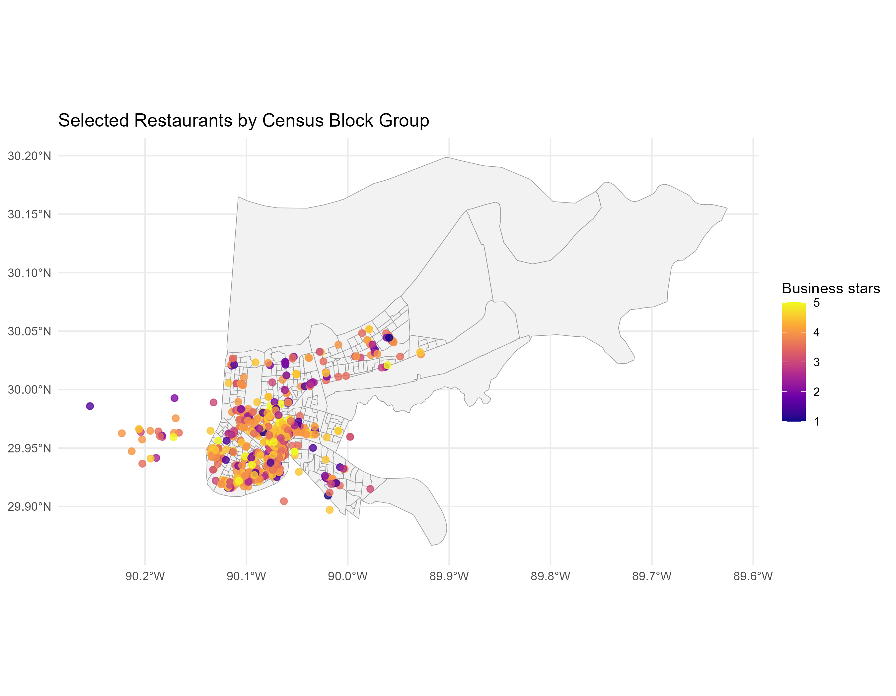
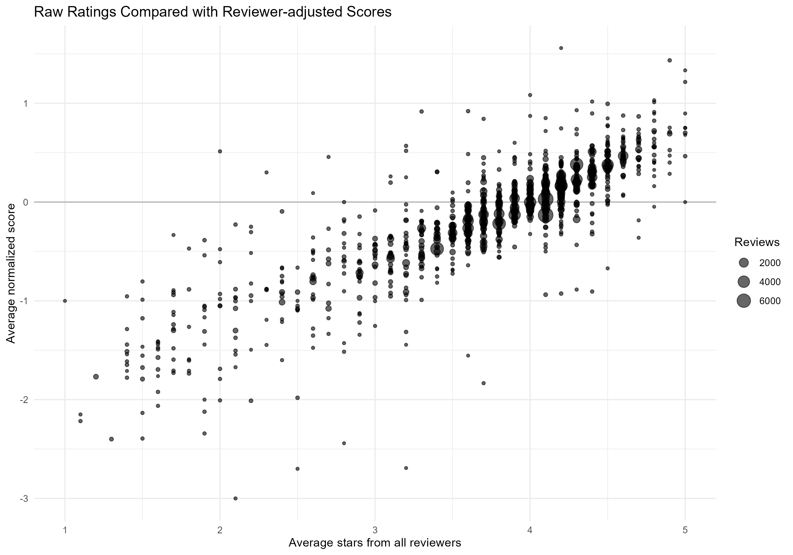
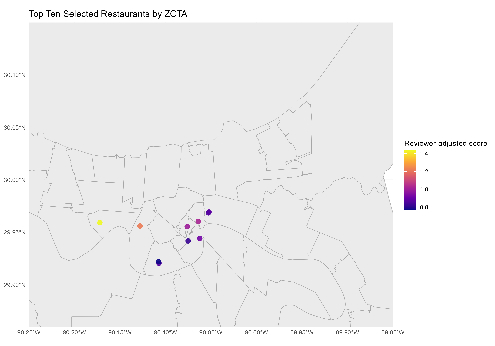

## Executive summary

This project uses the Yelp Open Dataset to study selected restaurants in New Orleans. I compare restaurant categories, geographic systems, business ratings, review activity, and reviewer-adjusted scores. I compare ZIP Code Tabulation Areas (ZCTAs), Census tracts, and Census block groups to determine which system gives the clearest and most complete view of restaurant locations. For the current analysis, I selected ZCTAs as the main geographic system. ZCTAs assigned all selected restaurants, were easier to understand, and produced the clearest map. Census tracts and block groups provided more detail, but they were more complex and left some restaurants unmatched.

## Research question

Where can someone find the strongest selected restaurants in New Orleans, and which geographic system provides the clearest way to compare them?

“Strongest” is evaluated using business ratings, review volume, and reviewer-adjusted scores. This analysis does not claim that Yelp represents every restaurant in New Orleans.

## Data and project structure

The project uses the Yelp Open Dataset business and review files. The original JSON files are too large, so they were stored locally and were not uploaded to GitHub. After importing and filtering the data, I created and saved smaller compressed RDS files.

The main source files are:

- `R/import.R` imports the large Yelp JSON files.
- `R/clean.R` filters the data to New Orleans restaurants and saves the RDS files.
- `R/new_orleans_restaurant_geography_analysis.R` creates the category and geographic outputs.
- `R/post_step6_final_analysis.R` creates the reviewer analysis, final rankings, and final figures.
- `new_orleans_restaurant_geography_analysis.qmd` contains the earlier geographic-system analysis.

The final report uses the tables and figures created by the analysis script.

```{r}
#| eval: false
#| include: false

# Run this separately before rendering if the output tables and figures
# have not already been created.
source("R/post_step6_final_analysis.R")
```

## Large-data management

I used `jsonlite::stream_in()` to import the large JSON files, kept only the columns needed for the project, and saved the filtered New Orleans data as compressed RDS files. This reduced the amount of data needed for later analysis. The raw JSON files remain local and are excluded from GitHub because of their size. But, the necessary RDS files are uploaded to GitHub. The review file contains millions of records, so the reviewer analysis can take longer and use more memory than the geographic summaries. The final HTML report contains the completed tables and figures and should not require a rerun for the large-data computations.

## Restaurant category selection

I selected the following related categories:

- Cajun/Creole
- Seafood
- Southern
- Sandwiches
- Fast Food
- Food Trucks

These categories combine foods connected to New Orleans with casual and convenient restaurant options. A restaurant was included if its Yelp category list contained at least one selected category. Because Yelp businesses can have multiple labels, one restaurant can appear in more than one category.

The complete category counts are available here:

tables/all_restaurant_category_counts.csv

The category co-occurrence table records which category pairs appear on the same business listings:

tables/category_cooccurrence.csv

```{r}
#| echo: false

category_counts <- read.csv(
  "tables/all_restaurant_category_counts.csv",
  stringsAsFactors = FALSE
)

knitr::kable(
  head(category_counts, 20),
  caption = "Most common restaurant categories"
)
```

```{r}
#| echo: false

category_cooccurrence <- read.csv(
  "tables/category_cooccurrence.csv",
  stringsAsFactors = FALSE
)

knitr::kable(
  head(category_cooccurrence, 15),
  caption = "Most common category pairs"
)
```

## Selected data

The selected dataset contains the businesses and reviews used for the category, geographic, and reviewer analyses.

Selected restaurant data: tables/selected_restaurants.csv

Selected data summary: tables/selected_data_summary.csv

Selected category geographic coverage: tables/selected_category_area_coverage_check.csv

```{r}
#| echo: false

selected_summary <- read.csv(
  "tables/selected_data_summary.csv",
  stringsAsFactors = FALSE
)

knitr::kable(
  selected_summary,
  caption = "Summary of the selected restaurant data"
)
```

The selected data contain 1,057 restaurants and 299,924 reviews across six
restaurant categories. The businesses use 30 postal codes, which provides a
preliminary indication that the selected restaurants are distributed across
multiple areas rather than concentrated in only one postal code.


## Restaurant locations

I converted the Yelp latitude and longitude values into `sf` point objects. These points were used for the spatial joins with ZCTAs, Census tracts, and Census block groups.



## Geographic systems

I compared these three geographic systems:

1. ZIP Code Tabulation Areas (ZCTAs)
2. Census tracts
3. Census block groups

ZCTAs are Census approximations of ZIP-code areas. They are useful for postal and business-location questions, but they should not automatically be described as neighborhoods. Census tracts are statistical areas designed for population and demographic analysis. Census block groups are smaller areas within tracts and provide more detail. For each system, I used a spatial join to assign restaurants to areas, counted the restaurants in each area, calculated average and median business stars, recorded total reviews, and checked for unmatched restaurants.

## Geographic comparison

Geographic system comparison: tables/geographic_system_comparison.csv

```{r}
#| echo: false

geography_comparison <- read.csv(
  "tables/geographic_system_comparison.csv",
  stringsAsFactors = FALSE
)

knitr::kable(
  geography_comparison,
  caption = "Comparison of geographic systems"
)
```

The detailed geographic summary files include restaurant counts, average business ratings, median business ratings, and total reviews for each area:

ZCTA restaurant summary: tables/zcta_restaurant_summary.csv
Census tract restaurant summary: tables/census_tract_restaurant_summary.csv
Census block group restaurant summary: tables/block_group_restaurant_summary.csv

```{r}
#| echo: false

zcta_ratings <- read.csv(
  "tables/zcta_restaurant_summary.csv",
  stringsAsFactors = FALSE
)

knitr::kable(
  head(zcta_ratings, 10),
  digits = 3,
  caption = "Selected ZCTA summaries with restaurant counts and ratings"
)
```

The geographic comparison should be interpreted using both coverage and detail. ZCTAs assigned all selected restaurants. Census tracts and block groups provided smaller areas, but each left some restaurants unmatched. All three systems also included areas with very few restaurants. In an area with only one or two restaurants, one business can strongly affect the average rating, so those averages are less stable/reliable. The comparison found 28 ZCTAs with 1,057 restaurants assigned and no unmatched restaurants. Census tracts contained 130 areas and assigned 1,030 restaurants, leaving 27 unmatched. Census block groups contained 209 areas and also assigned 1,030 restaurants, leaving 27 unmatched.

## ZCTA map



## Census tract map



## Census block group map



## Geographic system selection

I selected ZCTAs as the main geographic system. ZCTAs are simpler visually to understand, easier to display on a map, and complete for the selected restaurant points. They also provide enough geographic detail to compare restaurant concentration across New Orleans without creating an overly complicated map. Census tracts and block groups are useful when the research question requires very small areas or demographic detail. However, their smaller boundaries make the maps harder to read and can produce unreliable comparisons when an area contains very few restaurants. ZCTAs are not perfect because their larger boundaries can hide smaller neighborhood-level patterns, but they provide the clearest and most complete fit for this project’s restaurant-location question. But the unmatched Census tracts and block group counts could be due to how I handled their data. Nonetheless, ZCTAs still seem like the better choice overall for our current question. 

## Reviewer-adjusted ratings

I first calculated restaurant ratings using all available reviewers. I then identified reviewers who had written at least five reviews within the selected restaurant categories. For those eligible reviewers, I calculated each reviewer’s usual average rating and subtracted that personal average from each individual review. A positive normalized score means that a reviewer rated a restaurant higher than that reviewer usually rates restaurants. A negative score means the reviewer rated it lower than usual. This is not a new Yelp rating, rather it is a measure of how unusual the review was relative to the reviewer’s normal scoring behavior.

The original Yelp business-rating field is reported in half-star increments. For the final restaurant results, I use the mean of the individual review scores and round that review-based average to one decimal place. This produces values such as 4.8, 4.5, and 4.3 while preserving the original Yelp rating as a separate source field when needed. The main value we will look into is the average_normalized_mean_score	for every restaurant, when determining the ranking.

Reviewer-adjusted restaurant ratings: tables/reviewer_adjusted_restaurant_ratings.csv

Reviewer eligibility summary: tables/eligible_reviewer_summary.csv

```{r}
#| echo: false

reviewer_results <- read.csv(
  "tables/reviewer_adjusted_restaurant_ratings.csv",
  stringsAsFactors = FALSE
)

knitr::kable(
  head(reviewer_results, 10),
  digits = 3,
  caption = "Reviewer-adjusted restaurant results"
)
```

```{r}
#| echo: false

reviewer_eligibility <- read.csv(
  "tables/eligible_reviewer_summary.csv",
  stringsAsFactors = FALSE
)

knitr::kable(
  reviewer_eligibility,
  caption = "Reviewer activity and eligibility summary"
)
```



Raw versus adjusted ranking comparison: tables/raw_vs_adjusted_ranking_comparison.csv

The graph compares each restaurant’s regular average review rating with its reviewer-adjusted score. Restaurants that score high on both measures appear strong under both methods; for example, a raw average of 4.8 with an adjusted score of +0.8 would suggest strong performance. A restaurant with a raw average of 4.2 but an adjusted score of +0.5 may be performing better than its ordinary rating suggests, while a restaurant with a raw average of 4.7 but an adjusted score near −0.3 may have benefited from generous reviewers. A restaurant near 3.8 with a negative adjusted score would appear weak under both measures. Treat the adjusted scores as an additional perspective rather than a 100% assurance measure of quality.

## Final top-ten restaurants

The final top-ten table ranks selected restaurants by reviewer-adjusted score among restaurants with at least five reviews from eligible reviewers. This minimum reduces the chance that a restaurant is ranked highly because of only one or two adjusted/false reviews. In the rendered results, the top adjusted scores were led by 3 Southern Girls, Stella's Donation Cafe and Coffee Shop, Cafe Iguana, and Ms. Beasley's. Other restaurants in the top ten included Mona's Cafe, Dirty Dishes, Rainbow Grocery, Shank Charcuterie, The Neutral Ground Bar & Grill, and Bonafried. These rankings should be interpreted together with the number of eligible reviews because a high adjusted score based on a small number of reviews is less reliable.

[Top-ten restaurant results](tables/top_ten_restaurants.csv)

```{r}
#| echo: false

top_ten <- read.csv(
  "tables/top_ten_restaurants.csv",
  stringsAsFactors = FALSE
)

knitr::kable(
  top_ten,
  digits = 3,
  caption = "Top-ten selected restaurants"
)
```



The final map shows the top-ten restaurants over the selected ZCTA boundaries. The boundaries provide geographic context without treating ZCTAs as exact neighborhood boundaries.

## Limitations

The Yelp dataset does not represent every restaurant in New Orleans. The Yelp `city` field and Census boundaries may also differ because postal-city labels and geographic boundaries are not identical. Areas with very few restaurants have less stable averages, and reviewer-adjusted scores depend on the minimum reviewer threshold. Finally, the selected categories reflect the research question and are not a complete definition of all New Orleans food businesses. As an additional note, the available data we were working with is from 2020, so many of these restaurants most likely have slightly different ratings or could have possibly closed by now.

## Conclusion

This analysis examined 1,057 selected New Orleans restaurants and 299,924 reviews across six related categories. ZCTAs were selected as the main geographic system because they assigned all restaurants, were easier to understand, and produced the clearest map. Census tracts and block groups provided more detail but left 27 restaurants unmatched and contained many areas with very few restaurants.

Using reviewer-adjusted scores and requiring at least five eligible reviews, the top ten restaurants were 3 Southern Girls, Stella’s Donation Cafe and Coffee Shop, Cafe Iguana, Ms. Beasley’s, Mona’s Cafe, Dirty Dishes, Rainbow Grocery, Shank Charcuterie, The Neutral Ground Bar & Grill, and Bonafried. These results show how reviewer habits can affect restaurant rankings, but the adjusted score should be viewed as an additional measure rather than a perfect measure of quality. Because the Yelp data are a historical snapshot through 2022, the results may not reflect current restaurant ratings, ownership, or availability.

## Source code and outputs location

Import code: R/import.R

Cleaning code: R/clean.R

Step 1-6 analysis code: R/new_orleans_restaurant_geography_analysis.R

Post-Step 6 final analysis code: R/post_step6_final_analysis.R

Geographic comparison QMD: new_orleans_restaurant_geography_analysis.qmd

Category counts: tables/all_restaurant_category_counts.csv

Category co-occurrence: tables/category_cooccurrence.csv

Geographic comparison: tables/geographic_system_comparison.csv

Reviewer-adjusted results: tables/reviewer_adjusted_restaurant_ratings.csv

Raw versus adjusted rankings: tables/raw_vs_adjusted_ranking_comparison.csv

Top-ten restaurants: tables/top_ten_restaurants.csv

## AI assistance

I used AI assistance as a coding and troubleshooting resource throughout the project. I ran the code in RStudio, checked the outputs, reported errors, and adjusted the scripts when the results did not match the project requirements.

### Initial project planning

**Prompt:**  
“I have the full Yelp New Orleans project instructions. Can you identify every required step and deliverable, explain which files should complete each step, and create a complete workflow from importing the data through the final HTML report? Please include category analysis, spatial joins, geographic-system comparisons, reviewer-adjusted ratings, a top-ten restaurant list, maps, tables, limitations, and AI documentation.”

**Output and use:**  
The response broke the project into separate stages and connected each requirement to an R file, output table, figure, or report section.

**How I used it:**  
I used this workflow to plan the repository and track the project requirements. This helped me understand that the project required more than filtering the Yelp data; it also required geographic comparisons, reviewer analysis, visualizations, and a viewable final report.

### Creating the analysis R files

**Prompt:**  
“Create the R files needed for the full project. Keep the import and cleaning steps separate, create one file for the category and geographic analysis through Step 6, and create one final analysis file for the reviewer-adjusted ratings, top-ten restaurants, final map, and comparison plot. Use the existing RDS files and save the important outputs as CSV and PNG files.”

**Output and use:**  
The response created a modular R workflow with separate files for data import, cleaning, geographic analysis, and the remaining post-Step 6 analysis.

**How I used it:**  
I created the following files:

- `R/import.R` for importing the large Yelp JSON files.
- `R/clean.R` for filtering New Orleans restaurants and saving the RDS files.
- `R/new_orleans_restaurant_geography_analysis.R` for category analysis, spatial joins, geographic summaries, and maps.
- `R/top_ten_analysis.R` for reviewer-adjusted scores, rankings, the top-ten table, the final map, and the comparison plot.

I ran the files in order and checked that the expected tables and figures were created.

### Project setup and file organization

**Prompt:**  
“How should I organize a GitHub repository for the Yelp New Orleans project, and which files should be included?”

**Output and use:**  
The response suggested separate files for importing, cleaning, analysis, tables, figures, the QMD report, and the README. It also recommended excluding the large raw Yelp JSON files with `.gitignore`.

**How I used it:**  
I organized the project into separate folders for R scripts, tables, figures, and local data files. I kept the raw JSON and RDS files local and excluded them from GitHub.

### Importing and cleaning the Yelp data

**Prompt:**  
“How can I import the large Yelp JSON files into R without loading unnecessary columns?”

**Output and use:**  
The response recommended using `jsonlite::stream_in()` and selecting only the columns needed for the project.

**How I used it:**  
I used `stream_in()` in `R/import.R` and kept fields such as `business_id`, business name, city, state, latitude, longitude, stars, review count, and categories. I then filtered the data to New Orleans restaurants in `R/clean.R` and saved the results as compressed RDS files.

### Troubleshooting the review import

**Prompt:**  
“What does the `premature EOF` error mean when importing the review JSON file?”

**Output and use:**  
The response explained that the review file was incomplete or damaged, meaning that the file ended before the final JSON record was complete.

**How I used it:**  
I checked the raw file, re-extracted or replaced the damaged file, and reran the import before continuing with the analysis.

### Fixing missing objects in R

**Prompt:**  
“Why does R say that `business` or `new_orleans_reviews` cannot be found?”

**Output and use:**  
The response explained that objects created in one script are not automatically available in a new R session unless the script is sourced or the objects are saved and loaded.

**How I used it:**  
I separated the workflow into import, cleaning, and analysis files. The later scripts use `readRDS()` so they do not depend on manually created objects remaining in the console.

### Selecting restaurant categories

**Prompt:**  
“What restaurant categories could create a focused New Orleans analysis instead of including every type of business?”

**Output and use:**  
The response suggested selecting related categories and explaining why they belong together rather than simply choosing the most common categories.

**How I used it:**  
I selected Cajun/Creole, Seafood, Southern, Sandwiches, Fast Food, and Food Trucks. I included a business if it matched at least one selected category. I also created category counts and category co-occurrence results to support the category selection.

### Comparing geographic systems

**Prompt:**  
“How should I compare ZCTAs, Census tracts, and Census block groups for the Step 6 requirement?”

**Output and use:**  
The response recommended converting restaurant coordinates into `sf` points, using spatial joins, counting restaurants by area, calculating ratings, checking unmatched restaurants, and comparing maps.

**How I used it:**  
I compared all three systems and created a geographic comparison table. ZCTAs assigned all 1,057 selected restaurants, while Census tracts and block groups each left 27 restaurants unmatched. I selected ZCTAs because they provided complete coverage and were easier for a general audience to understand.

### Fixing the CRS spatial-join error

**Prompt:**  
“What does `st_crs(x) == st_crs(y) is not TRUE` mean?”

**Output and use:**  
The response explained that the restaurant points and boundary polygons used different coordinate reference systems.

**How I used it:**  
I transformed the boundary data to the same CRS as the restaurant points before performing the spatial joins. I then reran the joins and confirmed that the geographic comparison tables were created.

### Fixing the ZCTA boundary-year error

**Prompt:**  
“Why does `tigris::zctas()` say that the 2024 CB ZCTA file has not been released?”

**Output and use:**  
The response explained that the 2024 Census ZCTA file was unavailable through `tigris`.

**How I used it:**  
I changed the ZCTA boundary request to use the available 2020 file:

```r
tigris::zctas(
  cb = TRUE,
  year = 2020,
  class = "sf"
)
```

I also used 2020 geography files consistently for the other Census systems.

### Handling the `utf8.dll` problem

**Prompt:**  
“How can I continue when R gives an Application Control error involving `utf8.dll`?”

**Output and use:**  
The response explained that the problem was related to printing or loading a blocked package component, not necessarily an error in the data.

**How I used it:**  
I avoided printing very large tibbles to the console and instead wrote results to CSV files. I used functions such as `write.csv()`, `head()`, and `dim()` to inspect outputs without printing millions of rows.

### Creating reviewer-adjusted scores

**Prompt:**  
“How can I account for reviewers who consistently give unusually high or low ratings?”

**Output and use:**  
The response suggested calculating each reviewer’s usual average rating and subtracting that baseline from each individual review.

**How I used it:**  
I retained reviewers with at least five reviews in the selected category group. I calculated:

```text
reviewer-adjusted score =
individual review stars − reviewer’s average stars
```

A positive score means the reviewer rated the restaurant higher than usual. A negative score means the reviewer rated it lower than usual.

I created separate results using all reviewers and using eligible reviewers.

### Fixing the reviewer-analysis error

**Prompt:**  
“What causes the `auto_copy()` error when creating the reviewer eligibility summary?”

**Output and use:**  
The response identified a naming conflict caused by using `eligible_reviewers` both as a data frame and as a column name inside the same `tibble()` call.

**How I used it:**  
I calculated the reviewer counts before creating the summary table:

```r
eligible_reviewer_count <- nrow(eligible_reviewers)

eligible_selected_review_count <- selected_reviews |>
  semi_join(eligible_reviewers, by = "user_id") |>
  nrow()
```

I then used those separate values in the summary table.

### Improving the rating display

**Prompt:**  
“Can the final ratings be shown as 4.8, 4.5, and 4.3 instead of only Yelp’s half-star values?”

**Output and use:**  
The response explained that Yelp’s business rating field is reported in half-star increments, but a new average can be calculated directly from individual reviews.

**How I used it:**  
I calculated the mean of the individual review scores and rounded that review-based average to one decimal place. I kept the original Yelp rating separate from the new review-based average.

### Fixing the final map extent

**Prompt:**  
“Why does the top-ten map show Alaska, and how can I make it focus on New Orleans?”

**Output and use:**  
The response explained that `tigris::zctas()` returns nationwide ZCTA boundaries unless they are filtered or cropped.

**How I used it:**  
I restricted the final map to a New Orleans bounding box:

```r
xlim = c(-90.25, -89.85)
ylim = c(29.86, 30.15)
```

This keeps the top-ten restaurants and nearby ZCTA boundaries visible without showing the rest of the country.
